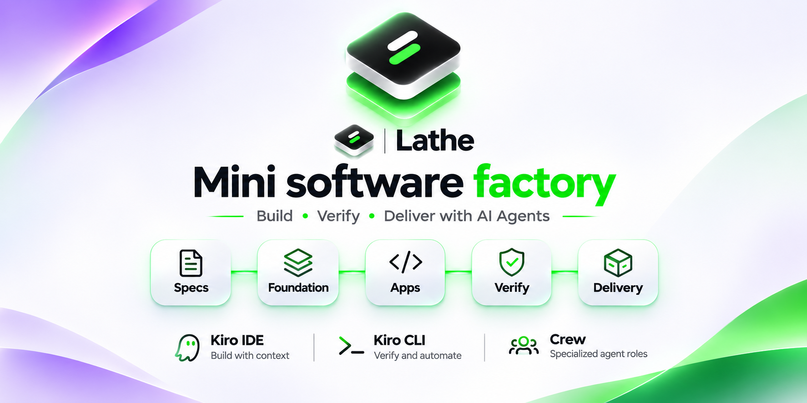

<div align="center">
  
  <p>
    <a href="#what-lathe-is">Code</a>
    ·
    <a href="docs/architecture/09-product-overview.md">Docs</a>
    ·
    <a href="#the-loop">How it works</a>
    ·
    <a href="ARCHITECTURE.md">Architecture</a>
  </p>
</div>

> [!NOTE]
> **Pre-alpha. Built for Kiroween 2026, Skeleton Crew category.**
> Partial today: the pnpm/TypeScript monorepo scaffold and the architecture decision records.
> Proposed: Factory Engine, Kiro runtime adapter, verification harness, Workspace UI, GitHub delivery, and both reference apps.
> Status per task lives in [TASKLIST.md](TASKLIST.md#status). Nothing below is described as working unless a task report says so.

## What Lathe is

Lathe builds, tests, verifies and ships multi-tenant applications with AI coding agents and deterministic engineering gates. Its thesis is simple: **an agent writes the code, Lathe verifies it independently, and the agent can never certify its own work.**

Lathe is made of:

- **Factory Engine:** owns the run state machine, starts sandboxes, drives Kiro, invokes verification, stores evidence and approvals. Only the Engine can record a gate as passed.
- **Verification harness:** deterministic gates (typecheck, tests with integrity checks, tenant isolation, RBAC matrix, deny-by-default, property-based tests, secret scan). Agents cannot edit it.
- **Application foundation:** reusable auth wiring, organizations, memberships, RBAC, tenant isolation with PostgreSQL row-level security, and audit events.
- **Lathe Workspace:** the operator UI for projects, specs, runs, gates, evidence and delivery.

## The loop

**Build → Debug → Verify → Ship.** Each step maps onto the Engine's run states:

| Loop step | Engine states | What happens |
|---|---|---|
| (before Build) | DEFINE | A human writes the spec. |
| Build | PLAN + BUILD | A planner agent drafts a plan, a human approves it, a builder agent produces a diff in a sandbox. |
| Debug | TEST + bounded repair | Gates run; on failure a repair agent receives only the failure evidence, for a limited number of attempts. |
| Verify | VERIFY | A fresh verifier container re-runs every gate on a clean tree. Only the Engine records a pass. |
| Ship | DELIVER | Lathe opens a **draft** pull request with evidence. A human approves and merges. No agent merges or deploys. |

Status: Proposed. The loop is designed ([ADR 0002](docs/adr/0002-kiro-integration-via-acp.md), [verification loop](docs/architecture/05-verification-repair-loop.md)) and not yet implemented.

## Architecture

Lathe is a TypeScript modular monolith with isolated sandbox containers for agents and verifiers. Start with [ARCHITECTURE.md](ARCHITECTURE.md), then the diagrams:

- [System architecture](docs/architecture/01-system-architecture.md)
- [Factory Engine](docs/architecture/02-factory-engine.md)
- [Kiro integration](docs/architecture/03-kiro-integration.md)
- [Generation workflow](docs/architecture/04-generation-workflow.md)
- [Verification and repair loop](docs/architecture/05-verification-repair-loop.md)
- [GitHub delivery](docs/architecture/06-github-delivery.md)
- [Tenant isolation and authorization](docs/architecture/07-tenant-isolation-authorization.md)
- [Deployment](docs/architecture/08-deployment.md)
- [Product overview](docs/architecture/09-product-overview.md)
- [Where Kiro features are used](docs/architecture/10-kiro-usage-map.md)

Decisions are recorded in [docs/adr/](docs/adr/README.md).

## Repository layout

```
.kiro/                         agents, steering and specs used to build Lathe with Kiro
packages/
  application-foundation/      tenancy, RBAC and audit foundation (scaffold only)
  verification-harness/        protected verification gates (scaffold only)
infra/                         local PostgreSQL 16 with separate owner and app roles
docs/                          architecture, ADRs, agent team, reports, brand assets
```

Planned, all Proposed:

```
apps/workspace/                landing page and operator Workspace
apps/support-desk/             reference app 1
apps/team-operations/          reference app 2
packages/shared-contracts/     typed interfaces between modules
services/factory-engine/       the Factory Engine
integrations/kiro/             Kiro ACP adapter, sandbox runner, runtime agent configs
integrations/github/           branch, commit and draft pull request delivery
templates/app-starter/         starter copied when creating a new app
```

## Reference apps

Two distinct applications, in two separate folders, built on the same foundation to show the skeleton's range:

- **Support Desk** (`apps/support-desk/`): tickets, assignments, SLA tracking, approvals, organizations, roles and permissions. Proposed.
- **Team Operations** (`apps/team-operations/`): projects, tasks, teams, shared resources and hierarchical permissions (org → team → project). Proposed.

Both import the same `packages/application-foundation`. Copying foundation code into an app is treated as a defect.

## Quickstart

Requirements: Node 22 (see `.nvmrc`) and pnpm 9.15.9 (see `packageManager` in `package.json`).

```bash
pnpm install
pnpm typecheck
pnpm lint
pnpm test
```

Today these commands check the scaffold only. There is no runnable product yet.

## How Kiro is used

Lathe uses Kiro in two separate ways. The full write-up is in [docs/kiro-usage.md](docs/kiro-usage.md), and the agent rules start at [AGENTS.md](AGENTS.md).

**To build Lathe (development time):**

- Eight custom agents in [`.kiro/agents/`](.kiro/agents/) (architect, backend, frontend, Kiro integration, security, verification, devops, documentation), each limited to the paths it owns.
- Six steering files in [`.kiro/steering/`](.kiro/steering/) for product, architecture, engineering standards, security, testing and agent workflow.
- Specs in [`.kiro/specs/`](.kiro/specs/), written as requirements, design and tasks.

**Inside Lathe (runtime, Proposed):**

- The Factory Engine drives Kiro CLI over the Agent Client Protocol (`kiro-cli acp`) inside a hardened sandbox, with no credentials except Kiro's and no MCP servers.
- Runtime agents are untrusted and can never touch the verification harness.

## Contributing

Read [CONTRIBUTING.md](CONTRIBUTING.md) and the [Code of Conduct](CODE_OF_CONDUCT.md). Each change maps to a task in [TASKLIST.md](TASKLIST.md) and ships with evidence: the commands run and their real output.

## Security

Security rules and the threat model are in [SECURITY.md](SECURITY.md). Report vulnerabilities privately through [GitHub private vulnerability reporting](https://github.com/lathedottech/Lathe/security/advisories/new), never in public issues.

## License

[MIT](LICENSE) © 2026 Oussama Rahamni
